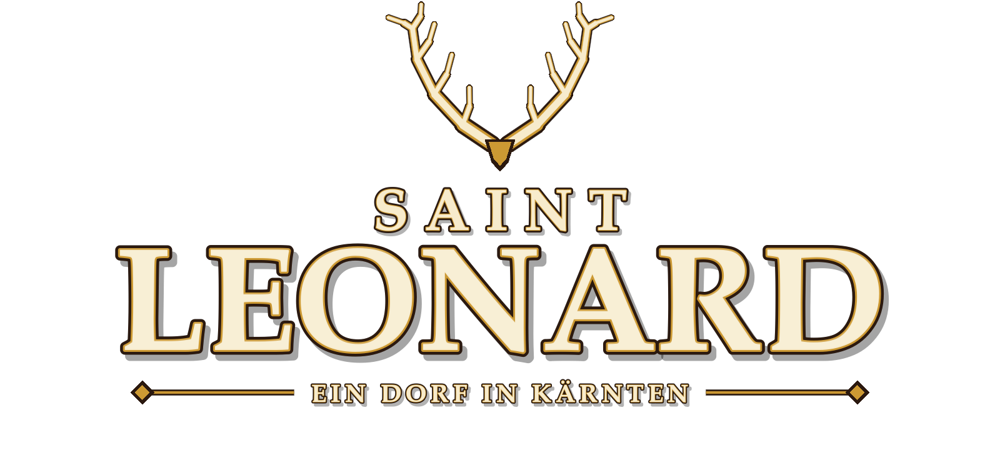

  

  <b>Jagen, Schnaps brennen, Offroad fahren, pokern und der Polizei entwischen.</b> 
  Eine Koop-Sandbox in einem Kärntner Dorf, gebaut mit Godot 4.

---

Du ziehst nach Saint Leonard, einem kleinen Ort zwischen Feldern, Wäldern und steilen Bergen. Das Gasthaus Pirtscher ist pleite, und der Inspektor aus der Stadt will zusperren. Mit deinem 4x4-Pickup, einem Gewehr und einem versteckten Brennkessel im Wald rettest du es, allein oder mit Freunden.

## Was man tun kann

- **Jagen:** Rehe, Wildschweine, Hasen, Füchse, Bären und ein Riesenhirsch. Erlegtes Wild ausnehmen, verkaufen oder als Trophäe im Gasthaus aufhängen.
- **Fahren:** 4x4-Pickup mit Anhänger, Matsch, Schäden, Seilwinde, Umbauten und echtem Radio.
- **Schnaps brennen:** Kessel im Wald, Temperatur halten, sonst knallt es.
- **Polizei:** Kontrollen, Bestechung, Verfolgungsjagden auf Feldwegen.
- **Leben im Dorf:** Haus kaufen und einrichten, Kleidung aus Fell herstellen, im Gasthaus und im Feuerwehrhaus Korpitsch einkehren.
- **Glücksspiel:** Spielautomaten, Roulette und illegales Poker (nur Spielgeld).
- **Mehrspieler:** ein gemeinsamer Server rund um die Uhr, Lobby vor dem Gasthaus, Sprachchat.

## Spielen

1. **Godot 4.7.2** installieren: `winget install GodotEngine.GodotEngine`
2. Repository klonen, `project.godot` in Godot öffnen, **F5**.
3. Namen eingeben, "Neues Spiel" oder "Mehrspieler".

Die wichtigsten Tasten: **WASD** laufen, **Maus** zielen und schießen, **F** benutzen, **G** tragen und laden, **I** Rucksack, **P** Handy, **M** Karte, **V** Ansicht, **B** Sprachchat, **F1** alle Tasten.

**Mehrspieler:** Im Menü "Mehrspieler" die Serveradresse eingeben (Port 24680, UDP). Nach dem Verbinden wartest du in der Lobby, bis alle bereit sind. Einen eigenen Server startest du im selben Menü oder rund um die Uhr mit `tools\start_server.bat`.

## Mehr dazu

| | |
|---|---|
| [ZUSAMMENFASSUNG.md](ZUSAMMENFASSUNG.md) | alles über Spiel, Systeme, Steuerung, Tests und Verlauf (Deutsch) |
| [docs/CO-DEV.md](docs/CO-DEV.md) | Anleitung für Mitentwickler (Englisch) |
| [docs/RELEASE.md](docs/RELEASE.md) | Builds für itch.io und Server auf dem Raspberry Pi |
| [docs/POLIZEI_SUMMARY.md](docs/POLIZEI_SUMMARY.md) | Stand der Polizei-Überarbeitung |

## Daten und Lizenzen

Kartendaten © OpenStreetMap-Mitwirkende (ODbL). Höhendaten: Terrain Tiles auf AWS (Mapzen/Tilezen). Radiosender über radio-browser.info, die Streams gehören den Sendern. Figuren und Tiere als 3D-Modelle in `assets/`, alles andere (Gebäude, Geräusche, Musik, Logo) entsteht im Code.
