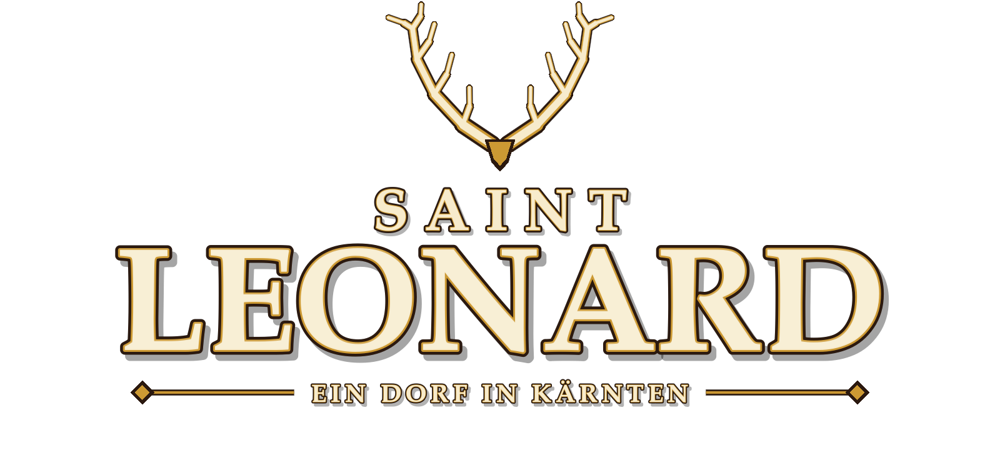

# Saint Leonard: Projektzusammenfassung

Stand: 2026-11-25. Diese Datei ist der Einstieg für neue Claude-Code-Chats und für alle, die am Projekt mitarbeiten. Sie beschreibt Idee, Entscheidungen, Zusammenarbeit, Aufbau, alle Spielsysteme, Steuerung, Mehrspieler, Werkzeuge, Tests, Verlauf und offene Punkte. Die kurze Vorstellung steht im [README](README.md), die englische Anleitung für Mitentwickler in [docs/CO-DEV.md](docs/CO-DEV.md).

## Inhalt

1. [Idee](#1-idee)
2. [Entscheidungen](#2-entscheidungen)
3. [Zusammenarbeit](#3-zusammenarbeit)
4. [Projekt und Werkzeuge](#4-projekt-und-werkzeuge)
5. [Kartendaten](#5-kartendaten)
6. [Welt im Spiel](#6-welt-im-spiel)
7. [Spielsysteme](#7-spielsysteme)
8. [Menü, Figur und Lobby](#8-menü-figur-und-lobby)
9. [Mehrspieler](#9-mehrspieler)
10. [Steuerung](#10-steuerung)
11. [Tests und Entwicklerhilfen](#11-tests-und-entwicklerhilfen)
12. [Release und Server](#12-release-und-server)
13. [Verlauf](#13-verlauf)
14. [Offene Punkte und Ideen](#14-offene-punkte-und-ideen)

---

## 1. Idee

**Saint Leonard** ist eine Koop-Sandbox für Marco und seine Freunde: jagen, Schnaps brennen, mit dem 4x4-Pickup über Feld- und Bergwege fahren, der Polizei ausweichen und gemeinsam das Gasthaus Pirtscher retten. Schauplatz ist ein Nachbau von Marcos Heimat in Kärnten (Gemeinde Arnoldstein), gebaut aus echten Kartendaten.

Vorlage sind drei Dokumente von Marco: "Saint Leonard - Full Game Brief" (Spielidee, Karte, Systeme, 3 Stufen), "Saint Leonard - Co-Dev Kickoff & Questions" (Zusammenarbeit mit einem Mitentwickler) und "Saint Leonard - Update & New Ideas" (Stil und Ton wie das Steam-Spiel Redneck Redemption, aber ohne Aliens; Feuerwehrhaus Korpitsch als Treffpunkt; Spielautomaten, Roulette und illegales Poker). Vom Referenzspiel übernehmen wir Genre und Ton, nicht dessen Grafik oder Figuren. Der frühere Arbeitstitel war "Riegersdorf City".

## 2. Entscheidungen

| Thema | Entscheidung | Warum |
|---|---|---|
| Engine | **Godot 4.7.2**, nativ unter Windows | Szenen und Skripte sind Text (Claude kann alles schreiben, Git funktioniert), eingebautes Netzwerk, Headless-Server. Das Kickoff-Dokument wollte Unity; Marco hat sich für Godot entschieden. |
| Sprache | **GDScript** | schlank, kein .NET nötig |
| Look | Mischung aus Cartoon und semi-realistisch | weiches Licht, natürlichere Farben, stilisierte Modelle, witzige Figuren |
| Karte | echte Daten (OpenStreetMap + Höhenmodell), Abstände × 1,7 | Saint Leonard = Riegersdorf + St. Leonhard, Stadt = Fürnitz, Tankstelle = echte Eni bei Hart, Südberge Richtung Wurzenpass. Simon hat die Abstände gestreckt, damit Fahrten länger dauern. |
| Google Maps | wird nicht verwendet | Nutzungsbedingungen verbieten das Übernehmen von Karten- und 3D-Daten |
| Versionsverwaltung | GitHub, privates Repo `MarcoAiche/Saint-Leonard` | Arbeit über Issues, ein Branch pro Issue |
| Mehrspieler | Godot ENet, ein dedizierter Server für alle (kein Host-Modus) | Marcos Wunsch. Läuft auf Marcos PC, dem Raspberry Pi oder einem Mietserver; Freunde über ZeroTier |
| Assets | Figuren und Tiere als 3D-Modelle (`assets/`), alles andere im Code | Simon hat GLB-Modelle für Figuren, Tiere, Bäume und Waffen eingebracht. Gebäude, Geräusche, Musik, Logo und Symbole entstehen im Code. |
| Cheats | keine im ausgelieferten Spiel | Debug-Startparameter wirken nur im Editor und in Debug-Builds |

## 3. Zusammenarbeit

- **Marco** (GitHub `MarcoAiche`) und **Simon** (GitHub `hrobathsimon-beep`) arbeiten parallel, beide mit KI-Unterstützung.
- **Issues** auf GitHub sind die Aufgabenliste. Wer ein Issue nimmt, weist es sich zu. Jedes Issue bekommt einen eigenen Branch (`feature/...` oder `fix/...`), der Commit schließt es mit `Closes #n`.
- **Konflikte vermeiden:** Vor dem Start prüfen, welche Dateien die offenen Branches des anderen ändern (`git diff --stat main...origin/<branch>`). Simon arbeitet derzeit an Polizei (#23, Branch `feature/police-overhaul`), Oberflächen im Spiel (#16) und Waffen- und Ladenfortschritt (#20).
- **Mehrere Branches gleichzeitig:** mit Git-Worktrees unter `.worktrees/` (steht in `.git/info/exclude` und hat eine `.gdignore`, damit Godot die Kopien nicht importiert).
- **Commits von Claude** tragen die Zeile `Co-Authored-By: Claude`. Gepusht und zusammengeführt wird nur auf Marcos Wunsch.
- **Lokales bleibt lokal:** `build/` ist im `.gitignore` (nur das oberste, `scripts/build/` gehört ins Repo).

## 4. Projekt und Werkzeuge

- Projektordner: `D:\Library\Documents\Code-Win\Saint-Leonard`.
- Godot per winget, Konsolen-Exe: `%LOCALAPPDATA%\Microsoft\WinGet\Packages\GodotEngine.GodotEngine_Microsoft.Winget.Source_8wekyb3d8bbwe\Godot_v4.7.2-stable_win64_console.exe`. Installierte Export-Vorlagen: nur Windows.
- GitHub CLI (`C:\Program Files\GitHub CLI\gh.exe`), angemeldet als MarcoAiche.
- Node.js für die Kartendaten (keine Pakete nötig).
- `project.godot`: Fenster 1600 × 900, MSAA 2×, 120 Physikschritte pro Sekunde mit Interpolation, Mikrofoneingang an, Symbol `assets/ui/icon.png`, Autoloads `GameState`, `Net`, `Voice`, `DebugTools`.

## 5. Kartendaten

`tools/build_world_data.mjs` erzeugt `data/riegersdorf.json` (ca. 18 MB):
- **Quellen:** OpenStreetMap über die Overpass API (gecacht in `data/raw/`) und AWS Terrain Tiles (Terrarium, Zoom 15; Berge rundherum Zoom 12 bis 9 km).
- **Koordinaten:** lokale Meter, x = Osten, z = Süden, y = Höhe über 498 m. Ursprung ist der OSM-Dorfpunkt Riegersdorf (46.5491278, 13.7806496).
- **Spielgrenze:** `tools/map_border.json`, ursprünglich aus Marcos Kartenbild umgerechnet, im Süden um die Berge erweitert. Raster = Grenze + 400 m Rand, 5 m Abstand.
- **Inhalt:** 2595 Gebäude, 1251 Straßen (mit Art, Belag und `tracktype`), Bahn, Bäche, Flächen, Orte, Sehenswürdigkeiten, ca. 357.000 Bäume.
- Aufruf: `node tools/build_world_data.mjs` (mit `--refresh` neu herunterladen).

## 6. Welt im Spiel

`scripts/world/world_builder.gd` (Klasse `WorldBuilder`):
- baut Gelände in 250-m-Kacheln, Berge rundherum, Wasser, Straßen, Bahn, Häuser, Bäume (MultiMesh mit Simons Baummodellen), Spielgrenze und Namensschilder.
- **Maßstab:** `MAP_SCALE = 1.7` streckt Straßen, Raster und Orte. Gebäude behalten ihre Größe, nur ihre Mitte wandert mit.
- **Baken:** Ergebnis in `data/world_baked.scn` (nicht im Git). Neu gebaut, wenn die JSON neuer ist, `BUILD_VERSION` (derzeit 9) sich ändert oder mit `-- --rebuild`.
- **Eigene Gebäude:** `SKIP_BUILDINGS` lässt OSM-Gebäude weg, die durch eigene Modelle ersetzt werden: Feuerwehrhaus Korpitsch (424764105) und Gasthaus Pirtscher (282883314).
- **Straßenklassen** (`road_info`): 1 Hauptstraße, 2 Dorfstraße, 3 Schotterweg, 4 Bergpfad.
- **Abfragen:** `height_at`, `road_info`, `trees_near`, `kind_at`, `slope_at`, `border_distance`, `nearest_poi`, `nearest_place`.
- `landmarks.gd`: Läden der Stadt, Tankstelle, Werkstatt, 10 Bauplätze, Polizeikontrolle, Startpunkt, Wirt Sepp vor dem Gasthaus.
- `sky_cycle.gd`: Tag und Nacht (ein Tag = 24 Minuten), Sonne und Mond, Wolken, Morgennebel, Regen.

### Gasthaus Pirtscher (`scripts/world/gasthaus.gd`)
Begehbar, auf dem echten Grundriss (Tür zur Straße, Stufe mit Rampe). Gaststube mit Schank und Kellnerin Gerti (gleicher Laden wie bei Wirt Sepp), Tischen mit Bänken zum Hinsetzen, Eckbank mit Herrgottswinkel, Stammtisch mit drei Stammgästen, Kachelofen, Geweihluster und der Trophäenwand. Zweistöckig von außen, grüne Fensterläden, Wirtshausschild.

### Trophäenwand (`scripts/world/trophy_board.gd`)
Beim Ausnehmen wird jede Trophäe vermessen (Rehbock in Geweihpunkten, Keiler nach Waffenlänge, Bär nach Schädel, Fuchs nach Balg; gleich bei allen Mitspielern, weil von der Tier-ID abhängig). Kapitale Böcke ab 120 Punkten, Keiler ab 20 cm, alle Bären und Füchse kommen in `GameState.trophies`. Im Gasthaus hängt man sie an die Wand (beste acht mit Messingschild), der Riesenhirsch aus Kapitel 3 bekommt den Ehrenplatz. Das Trophäenbuch zeigt alle Stücke und Rekorde je Wildart.

### Feuerwehrhaus Korpitsch (`scripts/world/fire_hall.gd`)
Zweiter Treffpunkt: Halle mit offenem Tor, Schlauchturm, Bar mit Kommandant Ferdl, Pokertisch, Roulette, Spielautomat, Darts, Biertische, altes Löschfahrzeug.

## 7. Spielsysteme

### Spielstand (`scripts/core/game_state.gd`, Autoload `GameState`)
Geld, Inventar mit Rasterposition, Magazin, Gesundheit, Ausdauer, Promille, Rauchzeit, Kleidung (`outfit`) und Kleiderschrank (`wardrobe`), Pickup (Lack, Umbauten, Sprit, Schaden, Ladung, Anhänger), Haus, Möbel, Hausruhe (`house_chest`), Fotos, Trophäen, Geschichte, Nebenaufträge, Statistik. Gemeinsame Welt: Uhrzeit, Tag, Wetter, Nässe, aufgestellte Dinge, Häuser, Polizeidruck. Gespeichert als JSON in `user://saves/<slot>.json`, automatisch alle 90 s, beim Pausieren und Beenden. Startausrüstung: Pistole, Sturmgewehr, Scharfschützengewehr, 80 Patronen, Messer, Taschenlampe, Bier, Zigaretten, Wurstsemmeln, 600 €.

### Gegenstände (`scripts/core/items.gd`)
Waffen und Ausrüstung, Getränke, Zigaretten, Essen, Zutaten, Aufstellbares, Anhänger, Möbel (auch großer Bilderrahmen, Truhe, Zimmerpflanze), Beute, Kleidung, Werkbank-Rezepte, 10 Häuser (2.500 bis 35.000 €), 8 Werkstatt-Umbauten, 8 Lackierungen.

| Werkbank-Rezept | Zutaten |
|---|---|
| Trophäe (Wandschild) | 1 Geweih |
| Keilerkopf | 1 Keilerwaffen, 1 Fell |
| Fellteppich | 2 Felle |
| Lederjacke | 3 Felle |
| Jägerhut mit Gamsbart | 1 Fell, 1 Keilerwaffen |
| Fellmütze | 1 Fell |
| Lederweste | 2 Felle |
| Lederhose mit Hirschhornknöpfen | 2 Felle, 1 Geweih |
| Fellrucksack | 2 Felle |
| Pelzmantel | 4 Felle |
| Gegrilltes Wildfleisch | 1 Fleisch |

### Spielfigur und Waffen
- `player.gd`: Ego-Perspektive (V schaltet auf Third Person), laufen, rennen mit Ausdauer, ducken, springen, Hochstand, Wild tragen, Ohnmacht.
- `character_model.gd`: Spieler und Mitspieler sind 3D-Modelle (Mann und Frau, mit Animationen), NPCs bestehen aus Grundformen. Kleidung siehe [Abschnitt 8](#8-menü-figur-und-lobby).
- `weapon_hand.gd`: Pistole (12 Schuss), Sturmgewehr (Dauerfeuer, 30 Schuss), Scharfschützengewehr (Zielfernrohr, ruhiger Atem), Fernglas, Taschenlampe. In Third Person hält die Figur die Waffe in der Hand.
- `camera_rig.gd`: Ego- und Third-Person-Kamera, Ego-Sicht im Auto, Rückstoß, Wackeln bei Alkohol.

### Wild (`scripts/animals/`)
Reh (Böcke mit Geweih), Wildschwein (Keiler greifen an), Hase, Fuchs, Braunbär (Südberge, greift an), Riesenhirsch (Kapitel 3). KI hört Schüsse, Hupe, Husten und Schritte, sieht schlechter bei Nebel, Nacht, geduckt oder vom Hochstand. Trefferzonen, Blutspur, Kadaver tragen, laden, ausnehmen oder verkaufen.

### Fahrzeuge (`scripts/vehicles/`)
- `truck.gd`: 4x4-Pickup mit Ladefläche (4 Plätze), Sprit, Schaden, Umbauten, Seilwinde, Kupplung hinten, Spanngurte pro Fahrzeug (gelbe Gurte über der Ladung).
- `trailer.gd`: **Anhänger** (Bauhaus, 1.500 €), wird mit F angekuppelt (PinJoint), 4 Ladeplätze, eigene Spanngurte. Ungesicherte Ladung fällt bei über 35 km/h im Gelände herunter. Die Fleischerei kauft auch vom Anhänger. Mitspieler sehen den Anhänger samt Ladung.
- Motorgeräusch mit Gängen, Autoradio mit echten österreichischen Sendern.

### Polizei (`scripts/police/`)
Streifen, Kontrolle vor der Stadt, Alkotest, Durchsuchen, bestechen, rausreden, abhauen, Verfolgung. **Derzeit auf `main` pausiert** (`PoliceManager.ENABLED = false`), Simons Überarbeitung liegt auf `feature/police-overhaul` (Details in [docs/POLIZEI_SUMMARY.md](docs/POLIZEI_SUMMARY.md)).

### Häuser (`scripts/build/house_builder.gd`)
Begehbar mit Holzdielen, Vertäfelung, Deckenbalken, Küchenecke, Kachelofen, Garderobe und Werkbank. Zweistöckige Häuser haben ein Obergeschoss mit Treppe (unsichtbare Rampe), dort Bett und eingebaute Truhe (`chest_menu.gd`: einlagern und herausnehmen). Möbel lassen sich frei aufstellen, verschieben und einpacken; Bilderrahmen zeigen eigene Fotos, aufgestellte Truhen haben eigenen Inhalt.

### Schnapsbrennen und Aufstellbares
Brennkessel (mindestens 350 m von Orten), Hochstand, Wildkamera, Feuerstelle. Minispiel: Maische ansetzen, Temperatur zwischen 78 und 92 °C halten, sonst Explosion mit Rauchsäule.

### Geschichte und Aufträge (`scripts/missions/missions.gd`)
Drei Kapitel "Rettet das Gasthaus Pirtscher" (Ankommen, Der geheime Kessel, Die Legende und das Fest) und Nebenaufträge (Fleischerei, Sepp, Pannenhilfe, Seilwinde, Mutprobe).

### Oberfläche im Spiel (`scripts/ui/`)
HUD mit Ort, Uhrzeit, Geld, Gesundheit, Minimap und Tacho; große Karte mit Zoom und Wegpunkt; Läden, Werkstatt, Raster-Inventar mit Werkbank und Kleiderschrank, Handy (Nachrichten, Aufträge, Kamera, Wildkameras, Pannenhilfe, Chat), Pausemenü.

### Glücksspiel (`scripts/casino/`)
Spielautomat "Goldener Hirsch", Roulette (im Mehrspieler gemeinsame Runde), illegales Texas Hold'em ab 20 Uhr gegen Hias, Mitzi, Lois und Freunde, Razzien. Nur Spielgeld.

### Comedy und Ton
Große Köpfe, Gesichtsausdrücke, rote Nase im Rausch, Kärntner Sprüche, Schluckauf, Rülpser, Rußgesicht. Alle Geräusche synthetisch (`scripts/audio/sfx.gd`).

## 8. Menü, Figur und Lobby

### Titelbildschirm (`main_menu.gd`, `menu_stage.gd`)
Angelehnt an große Abenteuerspiele: Die eigene Figur steht auf einem Felsen über dem Dorf und schaut in die Abendsonne, Vögel ziehen Kreise. Das Logo steht oben rechts, das Menü als Textliste rechts unten (Pfeil vor dem gewählten Punkt), Spielername links unten, Version rechts unten. Ortsschilder und Namen von Figuren sind im Menü ausgeblendet. Der Aussichtspunkt wird automatisch gesucht (höchster Punkt im Ring um das Gasthaus mit freier Sicht und ohne Straße).

`MenuStage` ist die 3D-Bühne mit drei Kamera-Einstellungen, zwischen denen die Kamera fährt: `title` (Felsen), `figure` (Standspiegel) und `lobby` (vor dem Gasthaus). Die Unterseiten (Neues Spiel, Spielstände, Mehrspieler, Einstellungen) erscheinen als Glas-Panel rechts. Gemeinsamer Look in `menu_style.gd`.

### Logo und Symbol (`assets/ui/`)
Cremefarbene Schrift mit Goldrand, "SAINT" klein über "LEONARD", darüber ein Hirschgeweih, darunter "Ein Dorf in Kärnten". Das Spielsymbol zeigt das Geweih vor einem Bergsonnenuntergang und ist auch das Exe-Symbol (`icon.ico`). Beide zeichnet `tools/make_logo.tscn` neu (braucht die Schrift Book Antiqua oder Georgia, nur beim Erzeugen).

### Figur-Editor (`figure_editor.gd`)
Aufbau wie in modernen Koop-Spielen: links die Kategorien (Körper, Haare, Gesicht, Kopf, Oberteil, Hose, Rücken), daneben Varianten und Farbfelder, die Figur steht in der Mitte in einem Standspiegel auf einer Blumenwiese neben dem Gasthaus. Ziehen mit der Maus dreht sie, "Zufällig" und "Standard" links unten, großes "Fertig" (grün) und "Abbrechen" (rot) rechts unten. Im Menü über "Figur", im Spiel zu Hause über den Rucksack ("Kleiderschrank"; die Kamera schaut dann die eigene Figur von vorne an). Die Figur aus dem Menü wird in `user://figur.json` gemerkt.

### Kleidung (`scripts/player/outfit.gd`, `char_palette.gdshader`)
- **Farben:** Das 3D-Modell nutzt einen Farbatlas. Der Shader färbt Haut (Kopf und Hände), Oberteil, Hose (unterer Teil des Rumpfes und Beine) und bei der Frau die Haare um.
- **Teile:** Hüte, Frisuren, Bärte, Brillen, Jacken, Westen, Hosenträger und Rucksäcke sind Formen, die jedes Bild den Kopf- und Rumpfknochen folgen (relativ zur Ruhelage). Maße: Kopf ca. 0,53 m Würfel, Rumpf ca. 0,34 × 0,30 m.
- **Kategorien:** Körper (Mann, Frau, 6 Hauttöne), Haare (kurz, Seitenscheitel, lang, Glatze; 7 Haarfarben), Gesicht (Schnauzer, Vollbart, Kinnbart; Brille, Sonnenbrille), Kopf (Kappe, Jägerhut, Jägerhut mit Gamsbart, Haube, Bauhelm, Fellmütze), Oberteil (Hemd, Kapuzenpulli, Trachtenjanker, Warnweste, Arbeitsjacke, Lederjacke, Lederweste, Pelzmantel), Hose (Hose, Arbeitshose mit Werkzeuggurt, Lederhose), Rücken (Rucksack, Fellrucksack).
- **Freischalten:** Grundteile sind frei. Arbeitskleidung kauft man im Bauhaus (Warnweste 15 €, Bauhelm 25 €, Arbeitshose 50 €, Arbeitsjacke 70 €), Freizeitkleidung im Supermarkt (Haube 10 €, Sonnenbrille 12 €, Kapuzenpulli 35 €, Trachtenjanker 140 €), Fell- und Lederteile stellt man an der Werkbank her. Einmal angezogen bleibt ein Teil im Kleiderschrank. Gesperrte Teile zeigen im Editor, wo man sie bekommt. Beim Spielstart ersetzt `Outfit.sanitize` alles, was man in diesem Spielstand nicht besitzt.
- **Mehrspieler:** Kleidungswechsel gehen über den Server an alle (`Net.send_outfit`), die Mitspieler-Figur wird neu gebaut.
- Alte Spielstände (`jacket = true`) werden beim Laden übernommen (`Outfit.normalize`).

### Lobby
Nach dem Verbinden mit einem Server geht es nicht sofort ins Spiel, sondern in die Lobby: Alle Spieler, die gerade in der Lobby sind, stehen in einer Reihe vor dem Gasthaus Pirtscher (man selbst in der Mitte), mit Namen und Status darüber, daneben der eigene Pickup. Links oben die Liste mit allen Spielern auf dem Server ("wartet", "bereit", "im Spiel"), rechts unten "Bereit" und der große gelbe Knopf "SPIELEN", links unten "Figur ändern" und "Server verlassen". Sind alle in der Lobby bereit, startet ein Countdown von 3 Sekunden und alle gehen gemeinsam ins Spiel. Der Server merkt sich pro Spieler `state` ("lobby" oder "game") und `ready`.

## 9. Mehrspieler

**Ein Server, mit dem sich alle verbinden.** Die Welt läuft dort weiter, auch wenn niemand online ist. Der Server speichert die Welt (Uhrzeit, Wetter, Kessel, Hochstände, Häuser) und das Profil jedes Spielers unter seinem Namen.

- **Verbinden:** Menü "Mehrspieler", Adresse (Port **24680 UDP**, andere Ports als `adresse:port`), Passwort falls gesetzt. Danach Lobby (siehe oben).
- **Server auf dem eigenen PC:** "Server auf diesem PC starten und verbinden" im selben Menü startet das Spiel ohne Fenster als Server.
- **Server rund um die Uhr:** `tools\start_server.bat` oder `tools/start_server.sh`, Raspberry Pi siehe [Abschnitt 12](#12-release-und-server). Optionen `--port=`, `--password=`, `--name=`, `--max=`, auch in `user://server.cfg`.
- **Anmelden:** Name, Kleidung, Version und Passwort. Abgelehnt bei falscher Version, falschem Passwort, doppeltem Namen oder vollem Server.
- **Der Server verwaltet:** Tiere, aufgestellte Dinge und Kesseldaten, Häuser, Uhrzeit und Wetter, Roulette-Takt, Pokertisch, Razzien, Profile, Lobby-Status und Kleidung.
- **Jeder Client schickt:** Position und Zustand (15 pro Sekunde), Pickup mit Umbauten, Licht, Ladung und Anhänger, Polizeiautos.
- **Für alle:** Schüsse, Hupe, Explosionen, Rülpser, Chat, Sprachchat (B, in der Nähe räumlich, sonst Funk).
- Mitfahren auf Beifahrersitz und Ladefläche, Navi nur für den Beifahrer.
- Fremde Fahrzeuge sind "Puppet"-Fahrzeuge ohne eigene Physik (`Vehicle.puppet`).
- `net.gd` (Version `VERSION` = 0.5), `voice.gd`, `remote_player.gd`.

## 10. Steuerung

**Zu Fuß**

| Taste | Aktion |
|---|---|
| W A S D | laufen |
| Shift / C / Leertaste | rennen / ducken / springen |
| Maus links / rechts | schießen / zielen |
| 1 bis 6 oder Mausrad | Waffen, Fernglas, Hände frei |
| R | nachladen |
| F | benutzen, einsteigen, hinsetzen; Wild ausnehmen (halten) |
| G | Wild tragen, auf Pickup oder Anhänger laden, abladen |
| Z / X | rauchen / trinken |
| L | Taschenlampe |
| V | Ego- oder Third-Person-Ansicht |
| I | Rucksack, Werkbank und Kleiderschrank |
| P | Handy |
| M oder Tab | Karte (Klick setzt Wegpunkt) |
| N | Minimap ein/aus |
| B / J | Sprachchat: sprechen (halten) / stumm |
| F1 / Esc | Hilfe / Pause |

**Im Pickup**

| Taste | Aktion |
|---|---|
| W / S | Gas / Bremse und rückwärts |
| A D / Leertaste | lenken / Handbremse |
| L / K / H | Licht / Radio / Hupe |
| T, dann W | Seilwinde einhaken und ziehen |
| R | umgekipptes Auto aufstellen |
| F | aussteigen |

## 11. Tests und Entwicklerhilfen

`<godot>` steht für die Konsolen-Exe aus Abschnitt 4, Parameter nach `--`.

| Test | Aufruf | Erwartung |
|---|---|---|
| Selbsttest | `<godot> --headless --path . -- --selftest` | endet mit `SELBSTTEST FERTIG` und `Beendet.` |
| Syntaxprüfung | `<godot> --headless --path . --script tools/check_scripts.gd` | keine Fehler außer fehlenden Autoloads (normal in diesem Modus). Nach neuen `class_name` einmal `<godot> --headless --editor --quit --path .` |
| Mehrspieler-Test | Server `-- --server --mptest --quit_after=320`, dann `-- --join=127.0.0.1 --name=Anna --mptest=a` und `--name=Bert --mptest=b` (alle `--headless --path .`) | keine `FEHLER`-Zeilen, alle drei beenden sich sauber. Vorher prüfen, dass kein anderer Server Port 24680 belegt. |
| Lobby-Test | Server `-- --server`, dann zwei Clients mit `-- --showmenu=lobbyjoin --join=127.0.0.1 --name=Anna` (mit Fenster) | beide verbinden, sehen sich, starten nach "Bereit" gemeinsam |
| Anhänger | `-- --trailertest` | ankuppeln, ziehen, Ladung, Gurte |
| Haus | `-- --housetest` | Treppe hoch, Truhe |
| Gasthaus | `-- --gasthaustest` | von der Straße durch die Tür hinein |
| Trophäen | `-- --trophytest` | vermessen, aufhängen, Wand |
| Kleidung | `-- --wardrobetest` | freischalten, anziehen, Kleiderschrank |
| Menü-Bilder | `-- --showmenu[=saves|settings|multi|figure|lobby] --menuwait=2 --shot=bild.png` | Bildschirmfoto der Seite |
| Kleidungsübersicht | `<godot> --path . res://tools/outfit_sheet.tscn` | Bild mit acht Figuren in verschiedenen Outfits |

**Debug-Parameter** (`scripts/debug_tools.gd`, nur im Editor und in Debug-Builds): `player=x,z`, `drive`, `tp`, `cam=yaw,pitch`, `dist`, `time`, `weather`, `money`, `upgrades`, `animal=deer+boar` mit `freeze`, `shoot`, `use=beer`, `drunk=0.1`, `reloadtest`, `buyhouse=n`, `place=still+stand`, `police`, `menu=...`, `hold=aktion:sek`, `aim`, `keytest`, `radiotest`, `join`, `password`, `localserver`, `mptest=a|b`, `quit_after`, `name`, `wait`, `shot=bild.png`, `rebuild`.

## 12. Release und Server

Ausführlich in [docs/RELEASE.md](docs/RELEASE.md).
- `export_presets.cfg`: Windows, Linux, macOS, Linux-Server und Raspberry-Pi-Server (ARM64). Das Windows-Exe bekommt das neue Spielsymbol.
- `tools/build_release.ps1` exportiert alle Vorlagen, deren Export-Templates installiert sind, und packt Zips für itch.io; mit `-Upload -ItchTarget nutzer/spiel` lädt `butler` sie hoch (braucht Marcos itch.io-Konto).
- `tools/install_pi_server.sh` und `tools/saint-leonard-server.service` richten den Server auf dem Raspberry Pi als Dienst ein.
- Ein Release-Export ignoriert alle Debug-Startparameter.

## 13. Verlauf

1. Grundprojekt, Godot-Installation.
2. Welt aus OSM und Höhendaten, Cartoon-Look, Spielfigur, Auto, Oberfläche.
3. Größere Welt nach Marcos Grenze, Karte, Ton, schönere Häuser, Physik-Interpolation.
4. Umbenennung in Saint Leonard, GitHub-Repo.
5. Umbau nach dem Brief: alle Systeme aus Stufe 1 bis 3.
6. Nachbesserungen nach Marcos erstem Test: Waffenwechsel, Blutspur, Animationen, Rausch-Effekt, Online-Radio, Raster-Inventar, Hauptmenü mit Spielständen.
7. Update "New Ideas": Feuerwehrhaus Korpitsch, Spielautomaten, Roulette, illegales Poker mit Razzien, Comedy.
8. Mehrspieler nur noch mit einem Server für alle, automatischer Mehrspieler-Test.
9. Simon steigt ein: Karte mit Zoom und Wegpunkt, Pistole, Sturmgewehr und Scharfschützengewehr, Spielautomat neu gestaltet, breitere Straßen und Karte × 1,7, 3D-Figuren und -Tiere (mit Fuchs), Baummodelle, Polizei-Überarbeitung (pausiert).
10. Sieben Issues parallel in eigenen Branches (2026-11-25): Selbsttest-Absturz (#1), Absturz beim Beenden ohne Fenster (#2), Release-Builds und Pi-Server (#12), Anhänger (#3), Hausinnenräume (#5), begehbares Gasthaus Pirtscher (#4), Trophäenwand (#9). Alle zusammengeführt.
11. Neuer Titelbildschirm, Logo und Spielsymbol, Figur-Editor, Kleidungssystem mit Fell- und Arbeitskleidung (#8), Lobby vor dem Gasthaus (#15), Cheats entfernt (Branch `feature/start-lobby`).

## 14. Offene Punkte und Ideen

Offene Issues auf GitHub, Stand 2026-11-25:
- **Simon:** Polizei verbessern (#23), Oberflächen im Spiel neu gestalten (#16), Waffen- und Ladenfortschritt (#20).
- **Marco:** itch.io-Upload und Pi-Server in Betrieb nehmen (#12; Skripte fertig, es fehlen itch.io-Konto und die übrigen Export-Templates).
- Noch frei: Polizei-KI auf dem Server (#6), aus jedem Autositz in die Luft schießen (#7), Gruppentest und Balancing (#11), bewusstlose Freunde in den Pickup laden (#13), Karte bis Villach (#17), Google-Anmeldung und Cloud-Spielstände (#18), Fehler-melden-Knopf (#19), wichtige NPCs Hubert und Bibi (#25), 10-l-Bottich, Plane und Schmuggel (#24), Geräusche auf Distanz (#26), Blender-Modelle statt Grundformen (#10).
- Bekannte Grenzen: Die Frauenfigur hat ihre Frisur fest im Modell (nur die Haarfarbe ist änderbar, kein Bart). Trophäen gehören zum eigenen Spielstand, die Wand zeigt die eigenen Stücke.
